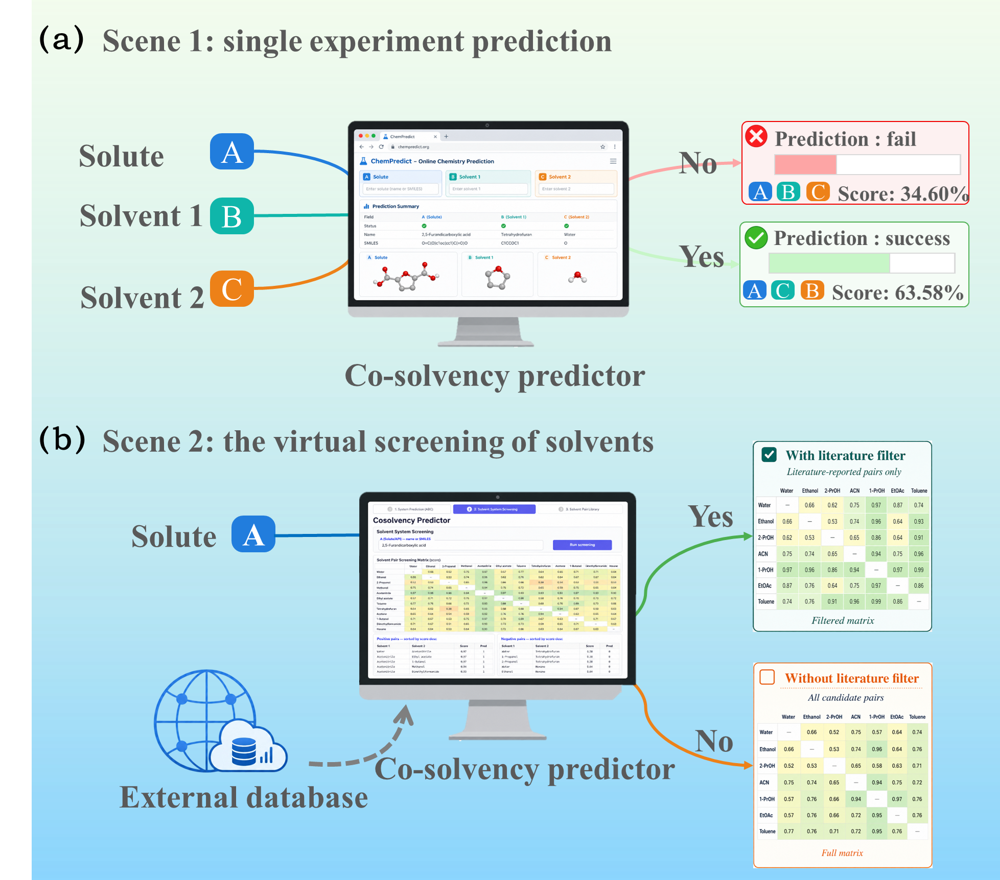

# CosolvencyWeb

**Cosolvency** occurs when a solute is more soluble in a binary solvent mixture than in either pure solvent. CosolvencyWeb predicts this behavior for a given solute–solvent system and screens candidate solvent pairs.

**SolutionNet** is a physics-guided graph learning model that treats the solute and two solvents as an integrated molecular system. It combines molecular graph representations with hydrogen-bond descriptors and intermolecular interaction energies derived from molecular simulations and density functional theory (DFT) calculations to predict the probability of cosolvency.

In the study, SolutionNet achieved **91.23% prediction accuracy** on a grouped independent test set.

[CosolvencyWeb](https://modelscope.cn/studios/luckyzsl/Cosolvency) · [SolutionNet](https://github.com/zhou-shilei/SolutionNet)

## Functions



*Figure 1. CosolvencyWeb workflows: (a) prediction for a specified solute–binary-solvent system; (b) virtual screening of candidate solvent pairs with optional literature-based filtering.*

- **Single Experiment Prediction**: Evaluate a solute (A) and two solvents (B/C) using SolutionNet or RandomForest. View molecular structures, prediction probabilities, and outcomes. SolutionNet can compare both solvent orders and use the higher probability; interaction descriptors can be populated from the database or edited manually.
- **Virtual Screening of Solvents**: Screen candidate solvent pairs for a target solute, with optional filtering for literature/database-reported pairs. Export the probability matrix as PNG and ranked results as Excel.
- **Solvent Pair Library**: Browse and filter recorded solvent pairs, then select a pair for prediction.

## Run Locally

Deployment environment: Python 3.11, PyTorch 2.3.1, and Gradio 4.44.0.

```bash
python -m pip install -r requirements.txt
python app.py --host 0.0.0.0 --port 7860
```

License: Apache License 2.0.
